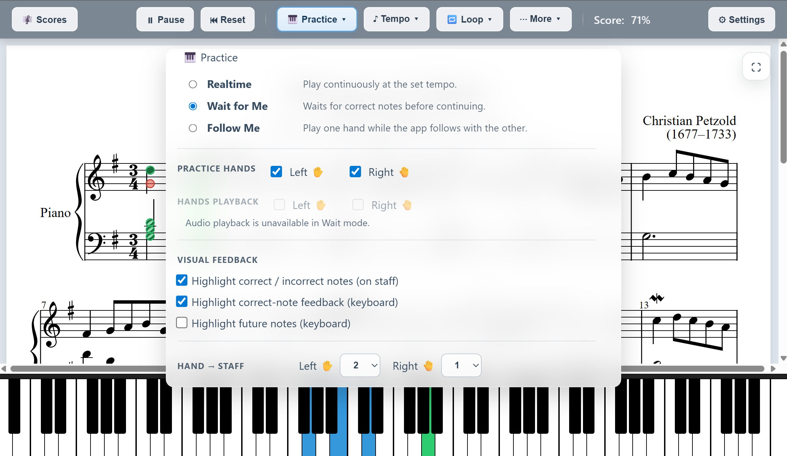
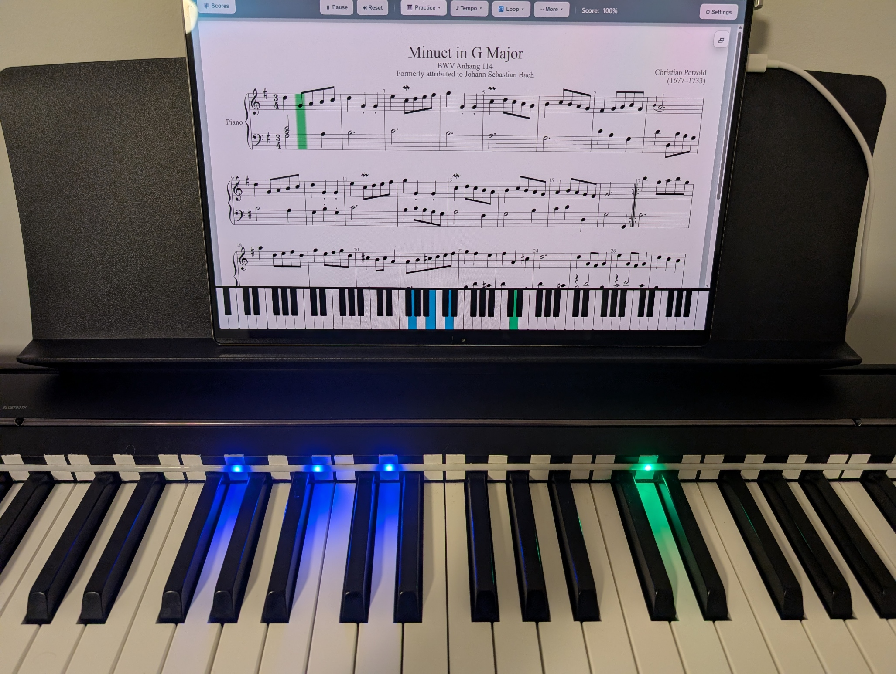

# 🎹 Piano Trainer Studio

Practice piano with real-time MIDI feedback, scoring, and optional LED guidance.

---

## 🌐 Try It

- App (GitHub Pages): [https://ztbishop.github.io/piano-trainer-studio/](https://ztbishop.github.io/piano-trainer-studio/)
- App (Custom Domain): [https://www.pianotrainerstudio.com/](https://www.pianotrainerstudio.com/)
- GitHub Repository: [https://github.com/ztbishop/piano-trainer-studio](https://github.com/ztbishop/piano-trainer-studio)

💻 Want to run locally? Download from the Releases page (no Git required)

👉 New here?
- Start with **Quick Start**
- Using iPad? See **iPad / iPhone**
- Want LED setup? Jump to **WLED / LED Setup**
- Want songs? See **Where can I find MusicXML songs?**

---

## 📦 Download (No Git Required)

You can download and run Piano Trainer Studio locally without cloning the repository:

👉 https://github.com/ztbishop/piano-trainer-studio/releases

- Download the latest `.zip` file under **Assets**
- Extract it to a folder on your computer

---

## Local address and updates

Live Server and the desktop/Wi-Fi launchers use `http://127.0.0.1:5500/` by default. Run only one app server at a time. The Wi-Fi launcher opens this local address and prints LAN addresses for your iPad/tablet in its console. The WLED helper remains at `http://127.0.0.1:4818/`; its transport and setup are unchanged.

Older launcher copies used port 8080. Browser storage is separate for each hostname/port: export your library and settings from the old address before importing them at 5500 if needed. Existing storage is never migrated or cleared automatically. `PIANO_TRAINER_APP_PORT` can override the launcher port.

Settings shows the running version and **Download latest release**. There is no automatic update check or reload; download a release for a local copy, or reload the hosted site. Normal version-based asset cache busting remains.

## 📸 Preview

### Main Interface

### Piano Setup with LED Feedback

---

## 🚀 What It Does

- 🎼 Play along with sheet music
- 🎹 Get real-time note accuracy feedback
- 🧠 Train using multiple practice modes
- 💡 Optional LED lighting synced to keys (WLED)

---

## ✨ Features

- 🎼 Load and play **MusicXML / MXL** piano scores
- 🔄 Import **MIDI, MuseScore 3.x, and Guitar Pro files 5.x** (auto-converted to MusicXML)
- 🎹 Real-time **MIDI keyboard feedback**
- 💡 Optional **LED visualization (WLED or MIDI LED devices)**
- 🌐 Runs in your browser — no install required
- 📱 iPad/iPhone support via MIDIWeb
- ⏱️ Various trainer modes

## 🎹 Practice Modes

- **Realtime** — play continuously at the set tempo
- **Wait for Me** — waits for correct notes before continuing
- **Follow Me** — play one hand while the app follows with the other

*Tip: Start with Wait for Me to learn notes, then try Follow Me to practice with timing.*

---

## ⚡ Quick Start (Desktop)

For development in VS Code, open `index.html` with **Live Server**. There is no frontend build or dependency-install step. Node.js is required only for the optional launchers/server and WLED helper below. See [Development and regression checks](docs/DEVELOPMENT.md).

### 1. Install Node.js (Required for launchers)

Download and install Node.js (LTS recommended):  
https://nodejs.org/en

### 2. Run the app
Open:
`Windows Launchers/Piano Trainer - Desktop.bat`

(or Mac equivalent)

### 3. Connect your MIDI keyboard
- USB recommended
- Bluetooth may vary by browser
- Optional: CME WIDI Bud Pro for wireless

### 4. Load a song
- Best: **MusicXML / MXL**
- Also supported: MIDI, MuseScore 3, Guitar Pro 5

### 5. Start practicing
- Press **Play** or open **Practice**
- Before pressing play, you can click any measure in the song to start playback there

### ℹ️ Notes
- No additional libraries need to be installed — all dependencies (including Tone.js) are already included
- If nothing opens, check the terminal/command window for errors
- On Mac, you may need to allow the `.command` file in System Settings → Security

---

## 🌐 Web Version (No Install)

Run directly from GitHub in your browser (Chrome recommended)

- Works great on desktop
- No helper required

⚠️ Notes:
- MIDI works on desktop browsers
- iOS Safari/Chrome do NOT support MIDI

---

## 📱 iPad / iPhone (MIDI Support)

iOS browsers do not support MIDI.

### ✅ Solution: MIDIWeb

1. Install **MIDIWeb**  
   [MIDIWeb on the App Store](https://apps.apple.com/app/midiweb-browser/id6757226617)
2. Open MIDIWeb
3. Load Piano Trainer 
4. Connect your MIDI device
- Note: Piano Trainer Studio should be visible on the main midiweb page as well.

🔵 Bluetooth MIDI (Optional)
- Tap the Bluetooth icon in MIDIWeb
- Connect your device
- It will appear in Piano Trainer

For local LAN hosting, open the following on a Mac/PC on your local network:
- `Windows Launchers/Piano Trainer - iPad (Wi-Fi).bat`
- (or Mac equivalent)
- Using the MIDIWeb app, connect to the resulting URL/IP displayed on your Mac/PC browser
- Be sure to use **http** (NOT https) when putting this URL into MIDIWeb

This launcher hosts the app only. WLED HTTP JSON sends directly from the browser to the controller; verify connectivity in MIDIWeb on your network. The DDP helper binds to localhost on its computer and is not exposed to the iPad by this launcher.

---

## 🎼 Supported Score Formats

### ✅ Best Compatibility
- `.xml`, `.musicxml`, `.mxl`

### 🔄 Supported via Conversion
- MIDI (`.mid`, `.midi`)
- MuseScore (`.mscx`, `.mscz`)
- Guitar Pro (`.gp`, `.gpx`, etc.)

⚠️ Notes:
- MusicXML is most reliable
- Converted formats may vary (MIDI does not contain key signatures, etc)
- Musescore 4+ import is experimental (<4 should work)
- Guitar Pro 6+ is experimental (<6 should be okay)
- If Musescore conversion issues occur → export to MusicXML using Musescore software
- If newer GuitarPro conversion issues occur → export to gp5 using TuxGuitar  or GuitarPro software

---

# 💡 WLED / LED Setup (Optional)

LEDs are optional but provide powerful real-time visual guidance while practicing.

---

## 🔹 Quick Overview

- Set **LED Lights → WLED** in Settings  
- Enter your **WLED IP address**  
- Set **LED Count (LEDs/m × strip length)**  
- Run **Test LED Strip**  
- Run **LED Calibration**  

---

## 🔹 Connection Modes

**HTTP JSON (default)**
- Sends directly to WLED; verify device/browser/network access on desktop or iPad
- Recommended for most users  

**DDP (low latency)**
- Run:
  `Windows Launchers/WLED Helper - Low Latency (DDP).bat`
- Faster response  
- Not supported on iPad  

---

👉 **Full LED Lights setup guide:**  
[Open LED Setup Guide](docs/LED-Setup.html)

---

## 🎹 Supported Input

- MIDI keyboard (USB or Bluetooth adapter)
- Optimized for piano
- CME WIDI Bud Pro is useful for picking up Bluetooth MIDI as a USB device

---

## 💾 Library & Backup (IMPORTANT)

Songs are stored in your browser (IndexedDB).

If browser storage is unavailable, the app warns you and keeps preference changes only for the current page session. Open File and bundled demos still work. The library offers **Retry library**; unavailable storage is not treated as an empty library or a successful save. Restore browser storage access and reload; **do not clear site data**, which could delete your saved scores. Settings backup/import/reset report failures rather than claiming success.

⚠️ Browsers may clear this data.

### Always:
- Use **Scores → Backup Library**
- Use **Settings → Backup All Settings**

### Where can I find MusicXML songs?

- **[MuseTrainer](https://musetrainer.github.io/library)** — Public domain MusicXML library with popular songs formatted for piano

- **[PianoML](https://www.pianoml.org/library)** — Another useful library for piano MusicXML content

- **[OpenScore](https://fourscoreandmore.org/openscore/lieder/)** — 19th-century classical art songs for voice and piano

- **[MuseScore](https://musescore.com/)** — Large collection of music. **Use a FREE account.**
  - Decline any promotional pop-ups or screens asking you to upgrade to MuseScore PRO or start a 7-day free trial
  - When searching, filter for public domain & original to bypass paywalls
  - Filter for Piano / Solo
  - Under DOWNLOAD, choose MXL / MusicXML
  - If prompted to pay, ensure you are logged in and search for anything that is **not** an official score. Some scores can be downloaded while logged into a free account

- **[GitHub](https://github.com/)** — Can be used to find MusicXML, though results may vary
  - Search within GitHub with your song name plus: `extension:mxl OR extension:musicxml piano`
  - Search within Google with your song name plus: `filetype:mxl OR filetype:musicxml "piano"`

- **[MusicXML](https://www.musicxml.com/music-in-musicxml/)** — List of websites to find MusicXML files

---

## 📂 Library & Scores

- **Current score** identifies the loaded song and whether it is saved, a demo, or temporary.
- **Save to Library** saves new/changed content without overwriting an existing song. Identical content is identified as saved; choose **Save a copy** to intentionally create another entry.
- **Add File(s)** uses the selected folder (Unfiled from All Scores or Demo Scores), shows progress, skips exact saved duplicates, and reports individual failures while continuing the batch.
- **Import Library (Merge)** previews what will be added or recognized. Repeat imports skip known identical entries; intentional copies and changed versions are preserved. Possible duplicates from older backups stay separate by default, unless you choose **Use existing entry**. Cancel makes no changes.
- Backup and import saved libraries
- Bulk import songs into your library
- Organize songs into folders
- Rename and manage songs from the library
- **Demo Scores** stays at the bottom of the folder list and is separate from All Scores and backups. Save a demo to your library to make an editable copy. Existing starter copies are kept.
- **Search title or filename** filters the selected folder, including embedded MusicXML work/movement titles when readable.
- Song **⋯** menus download saved MusicXML or MXL. Converted imports download their saved MusicXML, not the original MIDI/MuseScore/Guitar Pro file. Saved transpositions download the transformed score.
- Folder **⋯ → Export folder** downloads compatible JSON; use **Import Library (Merge)** to restore it through the same merge preview.

---

## Settings backups

Use **Settings → Backup All Settings / Import Settings** for preferences, connections, LED calibration and score-specific hand assignments. Current version-1 and older unversioned backups are supported. Invalid versions or supported values are rejected before settings change, with an error identifying the problem. Unknown legacy keys are ignored.

A successful import replaces global preferences; omitted globals return to defaults. Unrelated browser data and scores are preserved. Back up your current settings first if you want to keep both configurations. Library backups remain separate. If XML metadata cannot be extracted, staff assignments are tied to the exact original file contents; voice mapping is unavailable. Without usable source data, assignments are temporary.

## ⚙️ Key Controls

- **Practice Menu** — core training modes and feedback
- **Tempo** — speed + metronome
- **Loop** — repeat sections
- **Display** — Light / Soft Light / Dark appearance, zoom, virtual keyboard
- **Transpose** — key or semitone changes

---

## ⚠️ Known Limitations

### File Conversion
- MIDI / MuseScore / Guitar Pro may:
  - Load imperfectly
  - Require cleanup
  - Fail on complex scores

👉 Export to MusicXML for best results

### iPad
- No Web MIDI in Safari/Chrome
- Requires MIDIWeb app
- Local LAN app hosting uses a PC/Mac; WLED HTTP JSON connectivity depends on the device/browser/network. The localhost DDP helper is not available from the iPad.

### WLED
- DDP not supported on iPad

---

## 🛠️ Troubleshooting

### MIDI not detected
- Use Chrome (desktop)
- Use MIDIWeb (iPad)

### Import issues
- Convert to MusicXML (MuseScore app)

### Metronome MIDI Out sounds like a piano key
- MIDI Out click (Ch 10) Many devices play Channel 10 as percussion, but some keyboards may play regular instrument notes unless a Multi-timbral, GM, or drum-on-Ch10 receive mode is enabled.

### LEDs not working
- Verify IP
- Start with HTTP JSON

### Failed Musescore / GuitarPro conversion
- Use Musescore software or TuxGuitar to export.  

---

## 📘 Notes

- Web-first app
- Desktop = best experience
- iPad supported via MIDIWeb
- Do **not** block browser access requests
  - These are needed for MIDI and/or WLED
- Virtual Keyboard can be disabled in the Display menu
- Full-screen toggle is available in the top-right corner of the sheet

---

## 🙌 Credits

- OSMD
- WLED
- MIDIWeb
- MuseTrainer Library
- Node.js
- Tone.js
- Webmscore

---

## 📌 Project Status

Actively developed. Feedback and suggestions welcome.

## Development and New Chats

- [AGENTS.md](AGENTS.md): project rules, strict regression protections, and suggested commit text for every update.
- [Project context](docs/PROJECT_CONTEXT.md): current capabilities, decisions, limitations, and future ideas.
- [Architecture](docs/ARCHITECTURE.md): module ownership and data flow.
- [Development and regression checks](docs/DEVELOPMENT.md): Live Server, Node launchers, testing, and version guidance.
- [Historical development notes](docs/DEV_NOTES.md): past investigations and fixes.

For a new Codex chat opened in this project:

> Read AGENTS.md and the relevant project documentation, check Git status, and help implement: [describe changes]. Preserve existing behavior except for the changes requested. Leave commits and pushes to me, and provide a suggested commit title and description.

Keep current documentation updated when behavior or workflows change. Commits and pushes remain the project owner's responsibility.

---

## ❤️ Support

If you find this useful, consider sharing or contributing!

---

## License

AGPL v3.0

### Menu shortcuts

Practice shows your current mode/hands and enabled loop range; expand **Hand assignment** for staff/voice mapping. Find the experimental simple synth under **More → Audio / Routing**, alongside **Assigned hands** and **Accompaniment** output controls. On narrow screens, Tempo and Loop move into More. Settings puts MIDI/LED setup first, About below them, and Debug inside Advanced.
